# Red Hat MLflow as the flight recorder of the triage agent: spike results

*Date: 2026-10-12. Status: spike done on a test cluster; a proposal with the changes per repository
follows, with a go/no-go by 2026-10-16. This document changes nothing in the cluster.*

Today the triage agent is a black box on stage: the audience sees the alert and, later, the ticket.
The diagnosis text is discarded on the alert path, and each LLM call reaches the router as a separate
trace. Red Hat MLflow (component `mlflowoperator` of RHOAI 3.5.1) can record each investigation as a
trace in the RHOAI dashboard, inside the cluster: the alert, every LLM turn, every MCP tool call with its
arguments and output, the diagnosis, the ticket, and the votes of a local judge.

The spike checked this with the real agent code (`/app/agent.py` of the production image) and a copy of
its OGX server. The live `triage-agent` was not changed.

## Setup

| Item | Value |
|---|---|
| Cluster | OpenShift 4.22.16, RHOAI 3.5.1, test cluster on `main` |
| MLflow | 3.14.0. DataScienceCluster `mlflowoperator: Managed` (Ready in about 40 s), one cluster-scoped `MLflow` CR named `mlflow` |
| Storage | SQLite on a 10Gi `gp3-csi` PVC, artifacts served by MLflow (`file:///mlflow/artifacts`) |
| Address | In the cluster: `https://mlflow.redhat-ods-applications.svc:8443/mlflow` (service CA). Dashboard: `https://rh-ai.apps.<cluster-domain>/mlflow` |
| Workspaces | One MLflow workspace per namespace. The experiment `triage-agent-spike` lives in `agentic-triage` |
| Access | ServiceAccount token. A RoleBinding to the ClusterRole `mlflow-operator-mlflow-integration` in `agentic-triage` lets the agent create and update traces there; delete is denied, and `payments` is denied |
| Spike objects | All labelled `spike=mlflow`: one ServiceAccount, one RoleBinding, two pods (agent driver + OGX), one Secret |

## Results at a glance

| Step | Result |
|---|---|
| Access | No token: HTTP 401. No workspace header: HTTP 400. Write in `payments`: `PERMISSION_DENIED`. The dashboard shows the `agentic-triage` workspace without extra labels |
| Agent trace | Three real investigations of `AppHighErrorRate`: 36–48 s each, 5–7 LLM turns, 7–9 MCP calls, 60,590–72,957 tokens, one ticket each (`INC0000018`, `INC0000032`, `INC0000033`) |
| Time split | LLM turns take 2.4–16 s. MCP tool calls take 15–70 ms. On stage, almost all the time is model time |
| Link to the router | Plain OGX does not forward `traceparent`. OGX started with `opentelemetry-instrument` and `OTEL_*` env (a gitops-only change) sends it: Tempo shows one tree with the OGX call and the router decision |
| Fail-open | With MLflow unreachable the investigation never waits for MLflow. Numbers in [Findings](#findings-for-the-mvp) |
| Local judge | One request with the `legal` key: the router chose `local-fast` with `decided_by: tiering` (the chain alone would have chosen SOTA). 21 s, 5,901 tokens. Four LLM votes and two code checks written as assessments; the `mlflow-integration` role is enough |
| Tool calls tab | Empty with the MLflow SDK, full with plain OpenTelemetry spans. Two upstream issues, see [Upstream issues](#upstream-issues) |

## Screenshots

### 1. Where MLflow lives

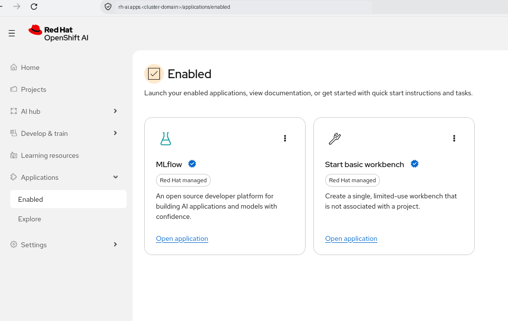

*Applications → Enabled.* MLflow is a Red Hat managed application after one change in the
DataScienceCluster and one `MLflow` CR.

### 2. One investigation, end to end

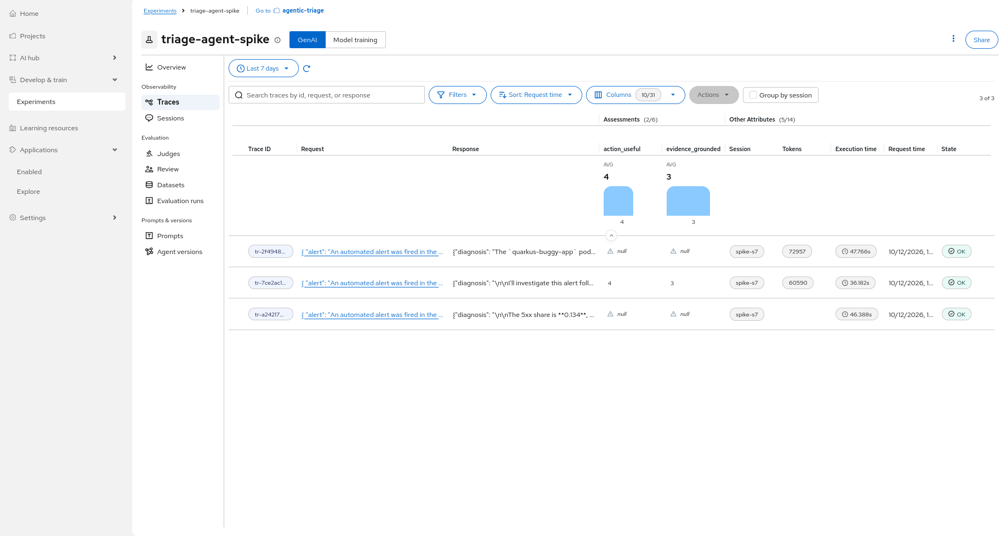

*Experiments → `triage-agent-spike` → Traces.* Three investigations with session, tokens, duration and
state. The oldest one has no token count: the first spike script stored the usage in a generic
attribute, and MLflow counts only `mlflow.chat.tokenUsage`.

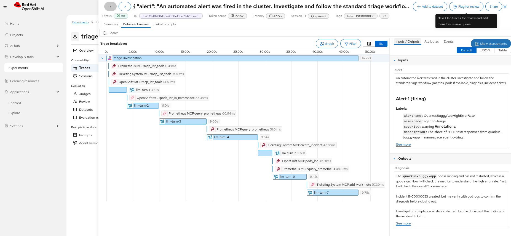

*Trace `tr-2f4948…`, ticket `INC0000033`, 47.8 s, 72,957 tokens.* The OGX tool loop as a timeline. LLM
turns take 2.7–9.8 s. The MCP calls (`pods_list_in_namespace`, three PromQL queries, `create_incident`,
`pods_log`, `add_work_note`) take 45–60 ms each.

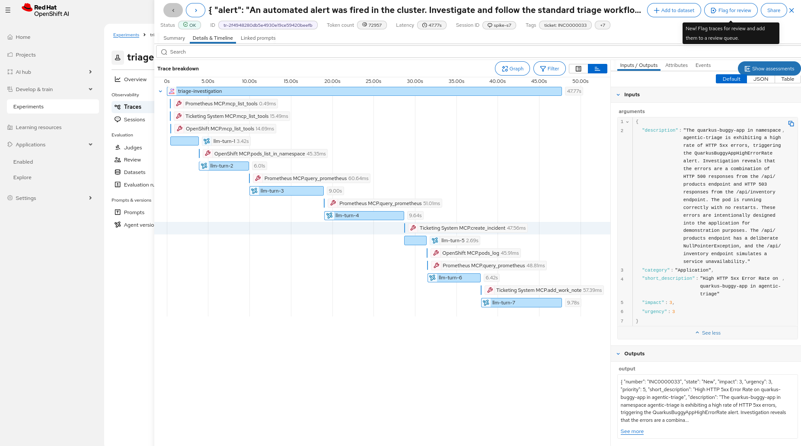

*Span `Ticketing System MCP.create_incident`.* Inputs: what the agent sent to the ticketing MCP server.
Outputs: the answer with `INC0000033`, state New, priority 5.

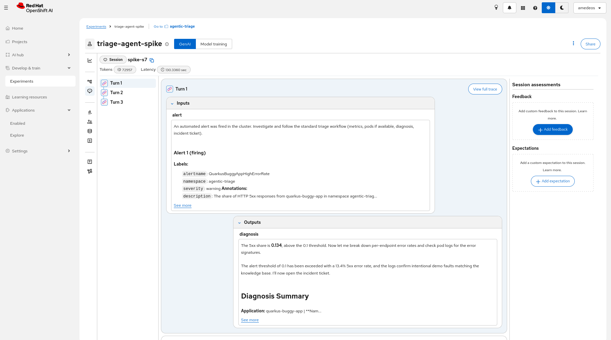

*Sessions.* The alert fingerprint is the session id, so repeated firings of the same alert group into
one session. Here: three investigations of the same alert.

### 3. The experiment overview

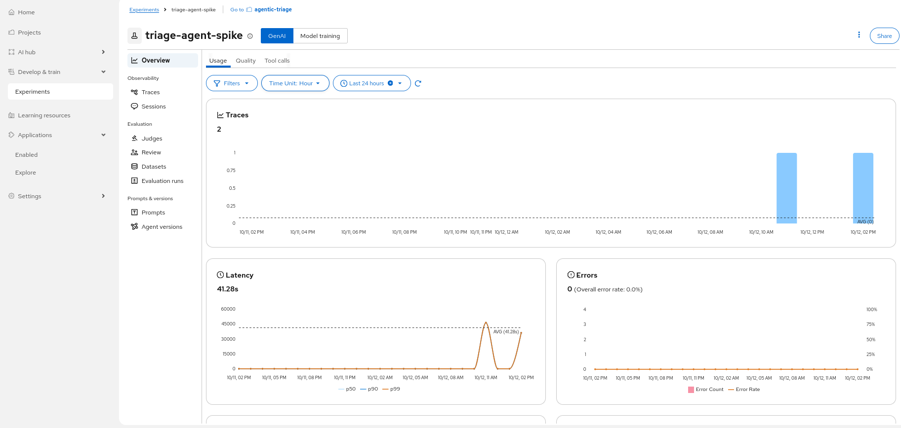

*Overview → Usage.* Trace count, average latency (41 s), errors.

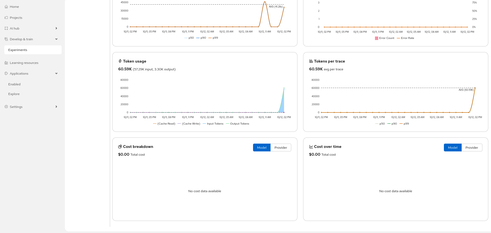

*Overview → Usage, lower part.* Tokens per trace. Cost is $0: MLflow prices models from the LiteLLM
price list, and the router aliases have no price.

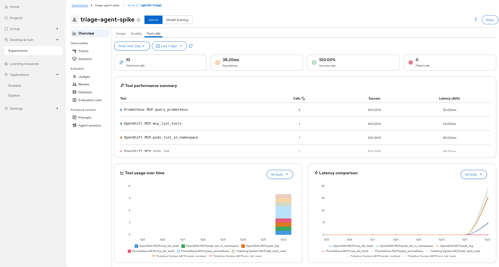

*Overview → Tool calls.* 10 MCP calls, 100% success, 38 ms on average. Three of them are
`mcp_list_tools` at start-up; the MVP leaves them out.

### 4. A local judge on the diagnosis

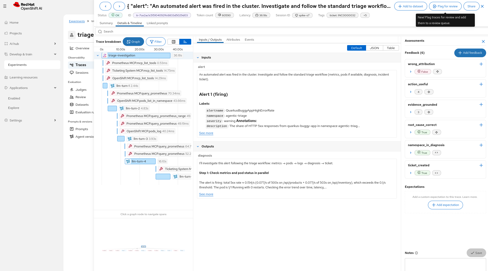

*Trace `tr-7ce2…` → Show assessments.* Four LLM votes (root cause correct, evidence grounded 3/5,
action useful 4/5, no wrong attribution) and two code checks (ticket created, namespace in the
diagnosis). The same panel takes human feedback and expectations (ground truth).

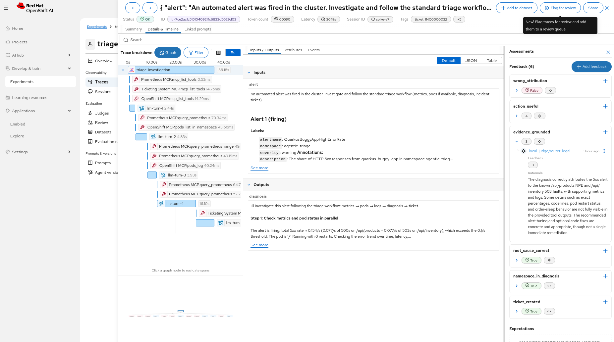

*`evidence_grounded = 3`, source `local-judge/router-legal`.* The judge explains its vote. Part of the
low score comes from the spike itself: the judge prompt cut each tool output at 700 characters.

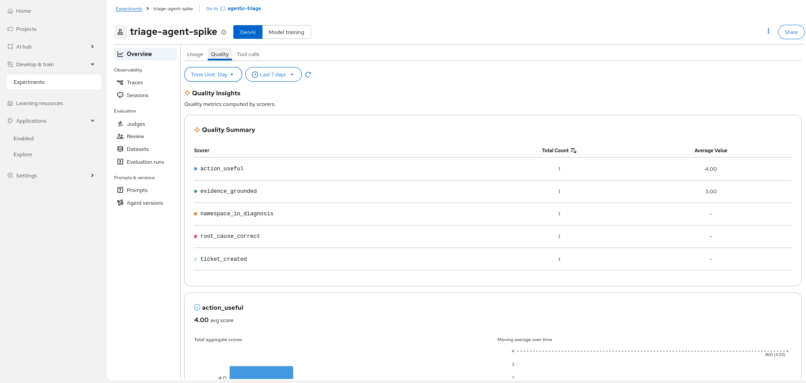

*Overview → Quality.* Averages of the numeric votes. The summary table shows five rows only.

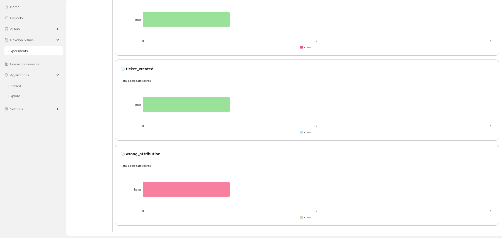

*Overview → Quality, booleans.* `wrong_attribution = false` is the good result, but the dashboard shows
it in red.

### 5. Why the Tool calls tab was empty

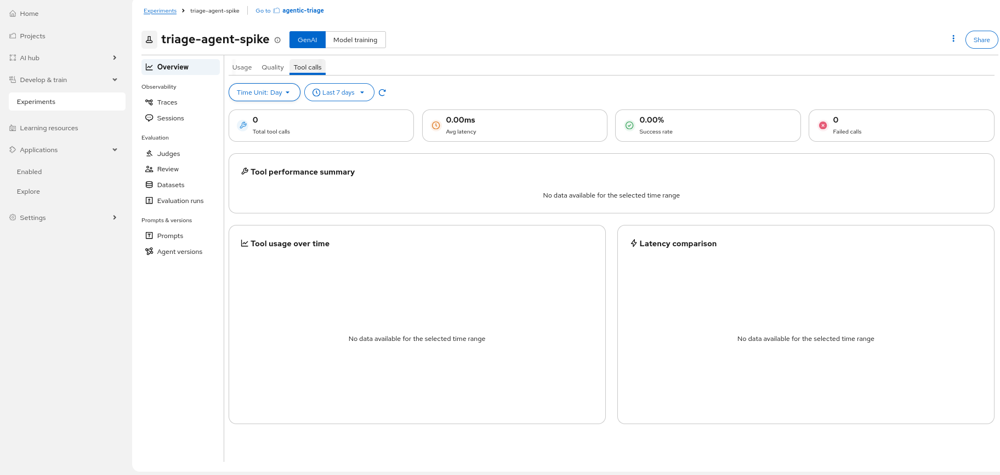

*MLflow SDK: empty.* The SDK uploads the spans to `/mlflow/v1/traces`, gets HTTP 404, and keeps the
spans only in an artifact. The span metrics of the dashboard read the database, so they stay empty.

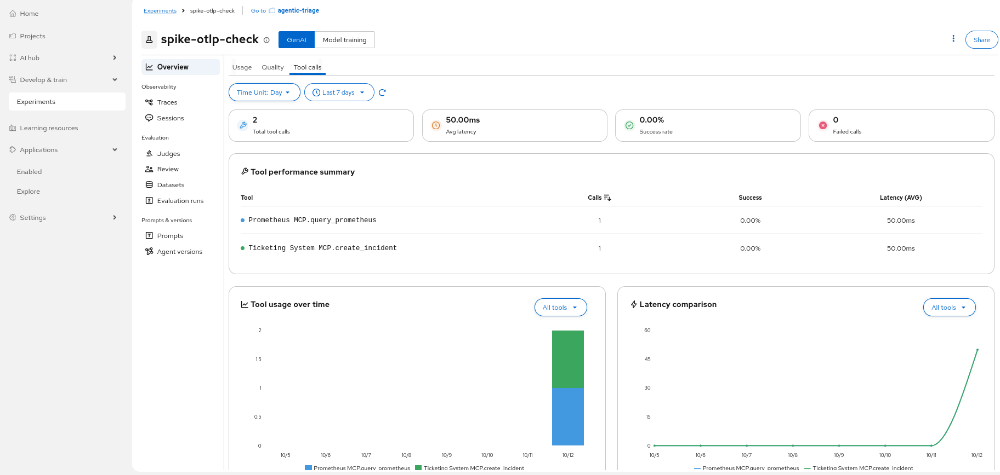

*Plain OpenTelemetry: works.* Spans built with the OpenTelemetry SDK, MLflow attributes as raw values,
sent via OTLP to the root path `/v1/traces`.

### 6. Link to the router decision

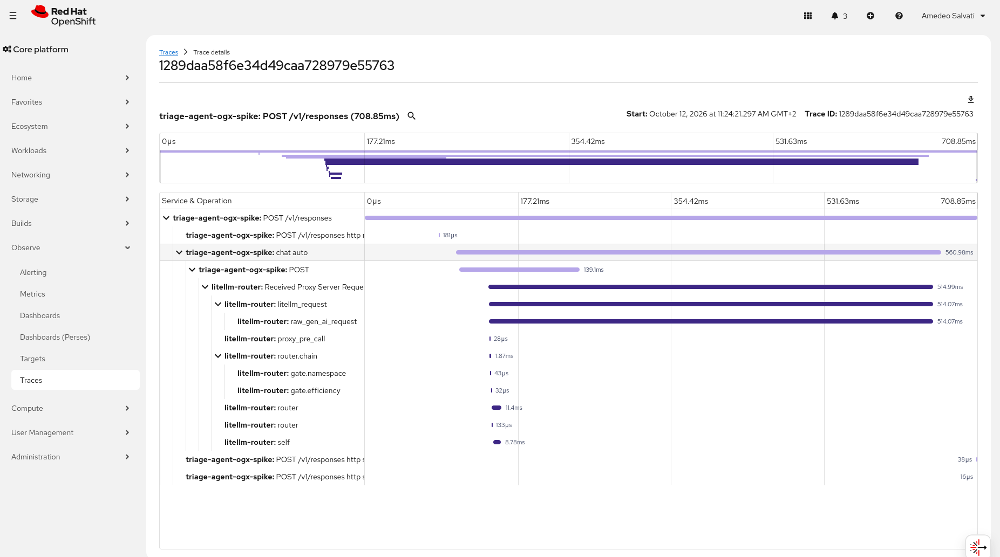

*OpenShift console → Observe → Traces.* With OGX started by `opentelemetry-instrument`, one trace holds
the OGX call (`POST /v1/responses`, `chat auto`) and the router decision (`router.chain` →
`gate.namespace`, `gate.efficiency`, then `litellm_request`). The agent root span was not sent to Tempo
in the spike, so the console shows "root span not yet received".

## Findings for the MVP

- **Export with plain OpenTelemetry, not with the MLflow SDK.** The agent builds the spans from the OGX
  event stream with the OpenTelemetry SDK, sets the MLflow attributes as raw values
  (`mlflow.spanType`, `mlflow.spanInputs` and `mlflow.spanOutputs` as JSON strings,
  `mlflow.chat.tokenUsage`, `session.id`), and sends them via OTLP/HTTP to
  `https://mlflow.redhat-ods-applications.svc:8443/v1/traces` with three headers: `Authorization`
  (ServiceAccount token), `x-mlflow-experiment-id` and `X-MLFLOW-WORKSPACE`. Tags such as the ticket go
  after the export, with one REST call each. This works around both upstream issues, uses the same
  stack as the instrumented OGX, and keeps the full MLflow package (938 MB) out of the agent image.
- **Refresh the token.** The OTLP exporter reads its headers once. The projected ServiceAccount token
  rotates, so the agent must read the token file again before it expires.
- **Fail-open, measured.**

  | Client | MLflow down (DNS) | MLflow down (blocked port) |
  |---|---|---|
  | MLflow SDK, default settings | `set_experiment` blocks 247 s | more than 400 s |
  | MLflow SDK, `MLFLOW_HTTP_REQUEST_MAX_RETRIES=0`, `MLFLOW_HTTP_REQUEST_TIMEOUT=3` | 0.2 s | 3.2 s |
  | Plain OpenTelemetry: creating 20 spans | 1 ms | 1 ms |
  | Plain OpenTelemetry: final flush (exporter timeout 5 s) | 2.9 s | 5.0 s |
  | One REST tag call, one attempt, timeout 3 s | 0.02 s | 3.0 s |

  So: a batch span processor, no flush on the request path, tags with one attempt and a short
  timeout, and a circuit breaker.
- **Span status.** Set `OK` on successful tool spans and `ERROR` on failed ones. With the default
  (unset) status, the Tool calls tab shows a success rate of 0%.
- **Leave out `mcp_list_tools`.** They are start-up calls, not actions of the agent.
- **Root output = final diagnosis only.** Today the stream text of all turns ("Now I will check…") is
  joined into one output. The judge should read the final diagnosis.
- **Votes in the positive form.** `attribution_correct` instead of `wrong_attribution`, so green always
  means good.
- **Ticket wording.** The tickets say the errors are "intentionally designed into the application for
  demonstration purposes". The agent takes this from `knowledge.md`. It may look odd on stage.
- **Judge.** Server-side online scoring is off: the operator sets `MLFLOW_SERVER_ENABLE_JOB_EXECUTION=false`.
  The judge stays a separate process that reads traces and writes assessments. Qwen used all 2048 output
  tokens for reasoning on the first try: the judge prompt needs `/no_think`.
- **Router link.** OGX with `opentelemetry-instrument` and `OTEL_*` env forwards `traceparent` to the
  router (gitops-only change). The agent root span should go to the collector too, so Tempo shows a
  complete tree. The MLflow trace keeps the OpenTelemetry trace id as a tag.
- **Sovereignty.** The operator also sets `MLFLOW_ENABLE_AI_GATEWAY=false` and
  `MLFLOW_ENABLE_ASSISTANT=false`: no MLflow feature calls an external model. The RHOAI dashboard has
  usage tracking on (`disableTracking: false`), as on every cluster of the demo today.
- **Security note.** The MLflow server ServiceAccount `mlflow-sa` can get and list Secrets in every
  namespace (ClusterRole `mlflow`, set by the operator).
- **Team users.** The admin sees the workspace. A Keycloak team user needs MLflow view rights in
  `agentic-triage`.
- **Data lifetime.** SQLite lives on a PVC of the cluster, so each new cluster starts empty. The show
  checklist needs one warm-up investigation.

## Upstream issues

To report to RHOAI (MLflow operator) and upstream MLflow:

1. **Static prefix and OTLP path.** The operator starts MLflow with `--static-prefix=/mlflow`. The REST
   API answers only under `/mlflow`, but the OTLP endpoint `/v1/traces` answers only at the root. The SDK
   sends spans to `<tracking URI>/v1/traces`, gets HTTP 404, logs it only at debug level, and keeps the
   spans in an artifact. Span metrics (Tool calls tab) stay empty, and a trace that mixes SDK spans and
   OTLP spans shows only the OTLP spans.
2. **Double encoding in OTLP mode.** With `OTEL_EXPORTER_OTLP_TRACES_ENDPOINT` set, the MLflow SDK sends
   attributes that are already JSON-encoded, and the server encodes them again. The span type is stored
   as `"TOOL"` with quotes, so the dashboard filter `span.type = TOOL` finds nothing.
3. **Silent no-op.** In OTLP mode without `opentelemetry-exporter-otlp-proto-http` installed, the SDK
   returns no-op spans without a warning.

## Next

- The proposal with the changes per repository (`ansible`, `gitops`, `triage-agent`,
  `triage-agent-operator`, `validation`), the demo script and the timeline follows. Go/no-go by
  2026-10-16.
- MLflow and the three traces stay on the test cluster for a live look until then. Until the spike is
  removed, nobody runs `site.yml` on that cluster: it would set `mlflowoperator: Removed` under a live
  `MLflow` CR.
